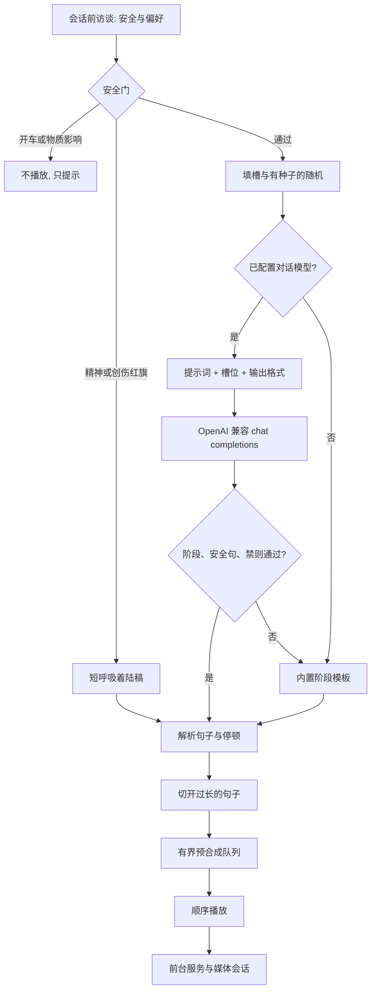
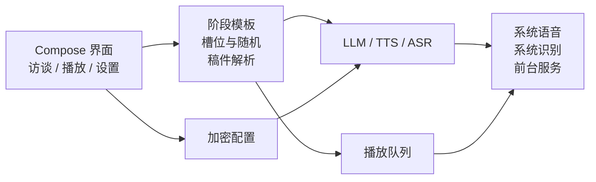
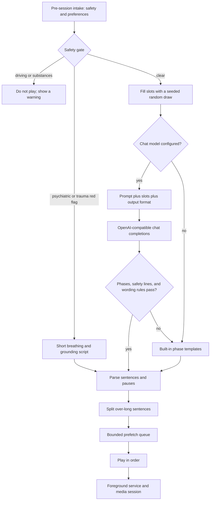
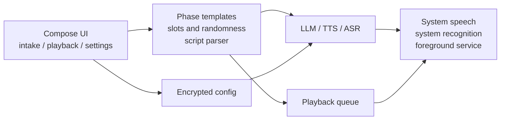

# 眠境 Dreamscape

语音引导的催眠与助眠 Android 应用。设计说明与证据备忘。整理日期：2026-11-27。

本文是产品设计与证据记录，不是系统综述，也不是医疗建议。证据等级与阅读状态沿用同日的设计笔记，不把笔记里没读到的内容补成看起来像引用的句子。

**实现状态。** 仓库里有一个可编译的 Android 骨架：会话前访谈、阶段模板与随机槽位、雨窗和林间两份内置中文样稿、整稿解析、有界预合成和按稿静音的播放、前台服务与媒体会话、三种可替换接口、本机加密配置、导入导出，以及 GitHub Actions 调试包。云端接口要使用者自己的密钥，仓库不代为接通某一家服务，也不把联调结果写成已经验证。签名发布构建默认关闭。分段加深、快速诱导、混淆诱导、惊吓诱导、年龄退行和失忆暗示**不做**。播放中无法处理情绪涌现，替代仍是会话前筛查和可退出句。

---

## 0. 给使用者的短摘要

手机上常见的催眠和助眠，是把稿子拆成一行一行来念：发出一句，就按固定时间接下一句。这个等待从「文字发出去」开始算，不是从「这一句真正说完」开始算。合成一慢，下一句的呼吸、下落或画面会叠到上一句还没说完的时候，人刚要沉进去，就被打断。

眠境的做法是：先把一整场写成一篇连续的稿，停顿以时长写进稿子，播放时变成真正的静音。间隔按写完的整稿排定，不跟每一句合成花了多久绑在一起。正式引导之前，先做一次会话前访谈，记下使用者自己的正向暗示和想停留的放松场景。

这是放松与助眠辅助，不是治疗，也不承诺对每个人都有效。

---

## 1. 证据约定

| 标记 | 含义 |
|---|---|
| 【已开】 | 设计笔记的整理者打开并读过原文页或全文 |
| 【摘要】 | 只读到摘要或检索结果中的片段，没有读全文 |
| 【行业】 | 培训机构或从业者网站，不是同行评审研究 |
| A | 有对照研究或系统综述支持 |
| B | 有综述或研究，但证据弱、样本小或结果混杂 |
| C | 行业传统做法；笔记中没有找到独立对照研究 |
| I | 设计推断，不是文献结论 |

笔记写明「未找到」的，这里保持未找到，不另补引用。阅读状态是笔记作者的，不是本文又做了一轮全文复核。

---

## 2. 催眠技术

各家文献里的骨架大体一致：前谈与期望 → 诱导（放松、聚焦、闭眼）→ 加深 → 想象与暗示 → 终止。临床和实验量表（Stanford、Harvard）也是这个顺序：一段标准化诱导，一组暗示，然后有终止程序（Kihlstrom 的研讨会幻灯片【已开】[7a]；APA Monitor【已开】[8]）。助眠场次的终止不是唤醒，见 2.10。

APA 第 30 分会的修订定义把催眠描述为「聚焦注意、外周觉察减少、对暗示反应能力增强的意识状态」，诱导是「为引发催眠而设计的程序」（Elkins、Barabasz、Council、Spiegel 2015【摘要，并经两处转引核对】[3]）。这个定义不要求神秘机制，也不等于失去控制。Kihlstrom 写过：催眠本质上是自我催眠，催眠师更像教练【已开】[7]。

### 2.1 分阶段对照

| # | 阶段 | 常见做法 | 目的 | 等级 | 眠境中的做法 |
|---|---|---|---|---|---|
| 0 | 前谈与期望 | 说明这是合作，不是被控制；澄清误解；问目标；说明可以随时睁眼、随时结束 | 把期望放在可核对的位置上，减少「会被控制」的误解 | B | 骨架：开场固定一句掌控权声明，极短，引导正文里不再提问。期望放在会话前访谈，不放进语音 |
| 1 | 访谈与筛查 | 目标、病史、禁忌、偏好、既往经历 | 安全，以及让内容跟得上这个人 | A（原则）/ C（具体题目） | 骨架：播放前一次做完。红旗者不进入想象。见第 6 节 |
| 2 | 渐进放松 | 肌肉紧了再松、自生训练的沉重与温暖、腹式呼吸、身体扫描 | 降低身体唤醒，给后面的注意聚焦一个依托 | B | 骨架：呼吸、躺好、被床或椅子接住。不做「必须先绷紧再松开」的测验 |
| 3 | 清空思绪 | 注意收到一个锚（呼吸、声音、身体一处）；念头经过，不去追 | 降低睡前觉醒和反复想 | B（机制）/ I（具体句子） | 骨架：写成「念头像云一样自己过去」。不写「什么都别想」 |
| 4 | 诱导 | 眼睛固定与疲劳闭眼；渐进放松；Elman 式快速法；混淆；惊吓 | 把注意收窄，为暗示准备条件 | B（诱导整体有用，形式差异小） | 骨架：只用闭眼、呼吸和渐进放松。快速、混淆、惊吓不实现 |
| 5 | 加深 | 倒数、楼梯、分段加深（fractionation）、手臂沉重或下落、累加暗示、身体扫描 | 把同一种放松再说深一层 | C | 骨架：身体扫描、楼梯、倒数三选一，一场一条主路径。分段加深不实现 |
| 6 | 意象 | 安全的地方；看、听、触、温度、气味；与睡眠相配的下沉隐喻 | 给注意一个可停留的内容 | B | 骨架：九层空间，由远到近。固定一句「这里很安全，一切都安稳。」 |
| 7 | 暗示与自我强化 | 直接或许可式短句；恢复应对感；睡眠场次用睡眠方向的句子 | 把场次的方向说清楚 | A（睡眠暗示的方向）/ B（风格、自我强化） | 骨架：短句、正向、能自然发生。助眠只指向更松、更沉、更安稳。使用者的句子先清洗 |
| 8 | 后催眠暗示 | 一个轻的线索（呼吸、肩沉、一个词），以后自己唤回放松 | 给日后一个条件线索 | B（实验室）/ I（助眠） | 骨架：只在日间场次留一句锚。助眠场次省略 |
| 9a | 唤醒（日间） | 把人带回房间，给清醒、轻松的句子，确认回到当下 | 终止要结构清楚，不把人留在很深的状态 | B | 骨架：日间场次必唤醒，固定句「睁开眼睛，就回到这个房间。」 |
| 9b | 睡眠过渡 | 不数数唤醒；句子变短变慢；邀请随时睡去 | 让录音停在睡眠门口 | B | 骨架：助眠收束不倒数、不点名唤醒，句子越来越短，停顿按稿子变长 |
| 10 | 事后 | 情绪涌现时留在支持性的状态里，必要时转诊 | 处理少数不适反应 | B | 单向语音做不到实时处理。替代是会话前筛查，加上语音里的可退出句。不计划做会话中的临床干预 |

20–30 分钟不是疗效门槛。Cordi 的录音约 13 分钟、932 个词（德语，语速很慢）【已开】[1]。时长在眠境里是体验选择。

### 2.2 各阶段再写清楚

**前谈与期望（等级 B）。** 行业培训把前谈和访谈放在诱导之前，用来设定期望【行业】[10]。研究一侧：对「会自动发生」的反应期望对催眠反应有预测力【摘要】[14]；消极态度会妨碍反应，单靠积极态度也造不出高易感性【已开】[7]。眠境的语音很短，因为播放开始后不再提问。计划中的固定句是：「这段话你一直都在掌控，想睁眼随时睁开，想停就停。」

**渐进放松（等级 B）。** BMJ 综述写过渐进性肌肉放松、自生训练和呼吸法的做法与安全性【已开】[9]。Cordi 的录音用约 4 分钟、10 步渐进式诱导【已开】[1]。2015 年失眠 RCT 荟萃（PubMed 26365453，笔记所读页面没有显示作者和刊名）里，自生训练或引导想象相对候补组也缩短入睡潜伏期（SMD −1.16），相对假干预没有显著差异（−0.50）【摘要】[4]。放松类和催眠类在现有对照里常常分不开。眠境不把「先绷紧肌肉」做成需要回报的测验。

**清空思绪（机制 B，句子 I）。** Elkins 2024 年的编辑部综述提到 Alldredge 等 2024：自我催眠之后，睡前觉醒和担忧下降，被当作可能的机制【已开】[6]。APA Monitor 引 Lifshitz：催眠状态下默认模式网络的活动下降，像日常解释世界的方式松开了【已开】[8]。「哪一种句子能清空思绪」没有独立对照研究，笔记标明未找到。写法是设计推断：允许念头过去，不命令空白。

**诱导（等级 B）。** Stanford / Harvard 量表的标准诱导是放松、聚焦注意、闭眼【已开】[7a]。Elman 流程强调让对方自己做出现象并重复，直到做到【行业】[11]，这需要看得见对方。混淆法和快速诱导，笔记只读到检索摘要，未打开原文，这里不引用具体效果。不同诱导形式对易感性分数的客观差异多数不显著；一篇 Bayes 重分析的摘要说「诱导形式是否重要尚未定论」，并认为标准诱导相对没有诱导仍有增益【摘要】[13]。眠境因此只保留闭眼和渐进放松，不实现 Elman 测验、混淆和惊吓。

**加深（等级 C）。** 行业资料把倒数、楼梯意象、分段加深列为常规【行业】[10]。该站点把这些方法联系到眼疲劳、肌肉放松和观念运动，笔记没有找到比较各种加深法的独立对照研究。Cordi 没有单独的倒数段，鱼向深处游的意象同时承担加深【已开】[1]。分段加深要对方睁眼、回应、再进去，单向语音不做。手臂漂浮一类观念运动需要核对「发生了没有」，没发生会削弱信心，眠境不核对。累加式暗示可以写成措辞（「更沉一点，再沉一点」），这是句子层面的计划，不是一项单独的生理测验。

**意象（等级 B）。** Cordi 使用鱼游向海底，并写明越深越安全、没有风险【已开】[1]。想象的鲜明程度基本不能预测易感性；吸收（absorption，容易沉浸的倾向）是更可靠但仍偏弱的相关，不能代替现场的易感性测验【已开】[7]。Landry 等的综述被 APA Monitor 转引，与心像相关的舌回有关联【已开转引】[8]。眠境用偏好决定哪一种感官写在前面，其余感官仍然出现，并允许「没有画面，只有感觉」。不按「视觉型才能进入、听觉型不能」来筛人。场景禁区见第 6 节：溺水、坠落、被困、医院，以及使用者标出的黑名单。

**暗示与自我强化（方向 A，风格 B）。** 睡眠暗示的方向有实验：Cordi 把「睡得更深」改成「睡得更浅」之后，慢波睡眠的增加消失；低易感性参与者在「更深」的暗示下，慢波睡眠量甚至减少；「相信会有效」本身不起作用【已开】[1]。Wofford 等 2023 的系统综述见第 3 节【摘要】[5]。直接暗示与间接暗示对客观反应几乎没有稳定差别【已开摘要】[12]。2026 年 Ericksonian 催眠的荟萃（8 项 RCT，N = 676）相对候补或常规照护的 SMD 为 1.17，与 CBT 或动机访谈大约相当，样本小、异质性高【已开】[15]，不能据此说许可式优于直接式。自我强化的经典描述是 Hartland 程序：逐步恢复对自己应对能力的信心【已开维基页，非一手】[19]；近年试验笔记只读到检索摘要，不引用效果数字。眠境的自我强化只在日间、只写能自然发生的应对感，不写「明天什么都能做到」。

**后催眠暗示（实验 B，助眠 I）。** APA Monitor 举了 Barnier 的寄明信片实验，以及 Raz 的 Stroop 研究：后催眠暗示可以改变高易感性者的行为表现【已开】[8]。助眠用途下没有专门证据。眠境只在日间留一个普通线索，例如肩膀沉下去；助眠场次不留锚，避免收束又变成一组新任务。

**唤醒与睡眠过渡。** APA 立场声明要求诱导和终止都结构清楚【摘要】[17]；行业资料把「干净地带回来」列为标准阶段【行业】[10]（等级 B）。助眠的依据是 Cordi：录音在暗示结束后停止，没有把听者带出催眠，而是邀请之后随时入睡【已开】[1]（等级 B，样本是高易感性年轻女性的午睡）。两条路径不能随机对调：要睡去的场次不唤醒；听完还要起来的场次必须唤醒。

### 2.3 许可式与直接式

风格不当作疗效开关。Lynn 等 1993 的综述以及后续工作里，许可式（间接）和权威式（直接）对量表上的客观反应没有稳定差异【已开摘要】[12]。抗拒量表高低者在直接与间接程序上的得分，1998 年的一项研究里也没有差别【摘要】[13b]。1988 年一个 40 人的小样本里，女性更偏好间接量表、男性更偏好直接量表【摘要】[13a]，不能推广成规则。

计划中的处理是接受度，不是疗效分层：

| 偏好 | 句子 |
|---|---|
| 许可式 | 多用「可以」「也许」「随你」 |
| 直接式 | 短句、肯定，「呼——，肩沉下去」 |
| 稍作解释 | 多一句原理，仍然不提问 |
| 默认 | 混合，偏许可 |

怀疑型使用者不写「你一定会深深睡去」。喜欢被指引的使用者少绕弯。两种都遵守同一条方向：助眠只说更沉、更松、更安稳。

### 2.4 易感性差异

易感性在人群里接近正态分布。APA Monitor 的转述是：大约 10%–20% 不太易感，大约同样比例高度易感，其余居中【已开】[8]。Piccione、Hilgard 与 Zimbardo 1989 年报告 Stanford A 量表在 10 年、15 年、25 年重测相关为 .64、.82、.71，成人易感性相当稳定【已开摘要】[8a]。低易感性不是「完全不能受益」：Elkins 认为可能需要更多练习和次数【已开，经 APA Monitor 与 Kihlstrom】[8][7]。Cordi 的结果更具体：低易感性者没有从「睡得更深」的暗示里获益，慢波睡眠量还有减少【已开】[1]。远程无法做 Stanford / Harvard 的现场评分，所以眠境**不设易感性门槛**，也不向任何人保证同等效果。

计划中的写法差异是篇幅和措辞，不是录取标准。自述不太容易进入的人：诱导更长、更重复，不依赖「手臂会飘起来」这种要验证的现象，并写明没有画面也可以。自述很容易进入的人：诱导可以短一些，同时更谨慎。Terhune 的工作被 APA Monitor 转引：高易感性与分离症状、PTSD 的关联更高【已开转引】[8]。高易感不是写得更猛的理由。

想象清晰度不用于预测。见 2.2 意象一节【已开】[7]。

### 2.5 禁忌、筛查与安全句

催眠在多数人是安全的，不良事件总体少，但报告也不充分（Chamine 等 2018【已开】[2]）。风险集中在特定人群和特定内容。

- Eimer 2012：多数不良后果出现在对通常禁忌的人群使用时，或情境激活了恐惧、羞耻、失控和不受控的分离。明显偏执、活动性精神病、精神分裂症、严重边缘性、明显分离症状、某些不稳定躯体疾病，除非有胜任者并在特定情境下，否则不应做催眠【摘要】[18]。
- Vickers、Zollman 与 Payne 1999（BMJ）：深度放松有时会加重心理问题，例如使创伤后状况再被触动，或在易感者中引出「虚假记忆」的担忧；精神病或癫痫史者在长时间深度冥想后有再发作的报道；边缘性人格、分离障碍、严重受虐史者应避免【已开】[9]。
- 一篇麻醉科实用文章（PMC10928374）写没有绝对禁忌，并建议正式催眠只用于「不用催眠也会治疗」的患者；会话式技巧适用范围更宽【摘要】[20]。
- APA 2015 年立场声明：催眠应由有资质的人员在充分评估的背景下进行【摘要】[17]。

这些证据主要针对临床催眠。单向语音放松的专门安全数据，笔记标明没有找到。眠境的做法是保守类推（I）：它是放松与助眠引导，不是治疗；筛查放在播放前一次做完，因为播放中看不见对方，也不能中途改流程。

计划中的安全问题：

1. 是否正在开车、走路或操作机器。是：不开始，先到可以躺下或坐好的地方。
2. 是否有精神病性障碍（如精神分裂症、躁狂或双相的发作期）、严重分离、癫痫，或近期强烈惊恐、自伤想法。
3. 是否有创伤经历，放松或闭眼时容易闪回、强烈不安或噩梦。
4. 现在是否受酒精或其他物质影响。是：不开始。
5. 失眠是否已超过一个月并影响白天。是：仍可听放松引导，并提示看医生。慢性失眠的一线非药物途径，Chamine 综述的引言提到 CBT-I【已开】[2]。

第 2、3 题为是：不做引导想象和深度下沉，改成可以睁眼的短呼吸与身体着陆，并建议联系专业人员。不讨论创伤细节。第 1、4 题为是：只提醒，不播放。

计划中的固定安全句（正向写法；安全句是语言禁则的例外）：

- 开场：「这段话你一直都在掌控，想睁眼随时睁开，想停就停。」
- 场景：「这里很安全，一切都安稳。」
- 助眠收尾：「耳朵放松地听，也可以直接睡去。」
- 日间：「睁开眼睛，就回到这个房间。」

未成年人默认不提供。不稳定的躯体疾病不在这个应用里处理。

---

## 3. 证据

### 3.1 Cordi、Schlarb 与 Rasch，2014

Cordi MJ, Schlarb AA, Rasch B. Deepening sleep by hypnotic suggestion. *SLEEP*. 2014;37(6):1143–1152.【已开全文】[1]

设计：70 名健康年轻女性，对照交叉，一段约 13 分钟的录音之后午睡 90 分钟，用 EEG。录音大约 4 分钟是 10 步渐进式诱导，接着是「鱼向海底越游越深」的意象。录音在这里停止，**不唤醒**，只邀请听者之后随时睡去。全文约 932 个词，德语，语速很慢。

结果：高易感性的年轻女性，慢波睡眠增加约 81%（八成以上），清醒时间减少约 67%。暗示改成睡得更浅之后，慢波睡眠的增加消失。低易感性参与者没有获益；在「睡得更深」的暗示下，慢波睡眠量还有减少。「相信会有效」本身不能解释这一结果。

这不是「睡眠本来就好的人」的研究，笔记和原文的分组都是**易感性高低**，样本是健康年轻女性。不能改写成「good sleepers」，也不能推广成「所有人的深睡都会增加八成」。作者自己强调：不是针对睡眠障碍人群。场景是午睡，不是夜间失眠患者。

对设计的直接含义：助眠场次不数数唤醒；暗示方向保持更深、更安稳；不对所有人承诺同样效果。

### 3.2 其他助眠研究

| 来源 | 设计 | 结果 | 局限 | 阅读 |
|---|---|---|---|---|
| Cordi、Schlarb、Rasch 2014，*SLEEP* [1] | 70 名健康年轻女性，交叉，13 分钟录音后午睡 90 分钟，EEG | 高易感性者慢波睡眠约 +81%，清醒时间约 −67%；更浅的暗示取消效应；低易感性者无益 | 年轻女性、午睡、健康人，不是失眠患者 | 已开 |
| Chamine、Atchley、Oken 2018，*JCSM* [2] | 24 项研究的系统综述 | 58.3% 有益，12.5% 混合，29.2% 无益；不良事件少 | 样本小、质量低、多为中年女性 | 已开 |
| Wofford、Snyder、Corlett、Elkins 2023，*IJCEH* [5] | 44 项系统综述 | 47.7% 阳性，22.7% 混合，29.5% 无效。要求有睡眠问题且含睡眠暗示的 11 项：54.5% 阳性，36.4% 混合，9.1% 无效 | 描述性，没有合并效应量 | 摘要 |
| 失眠催眠 RCT 荟萃，2015，PubMed 26365453 [4] | 6 项催眠 + 7 项自生或引导想象，502 人 | 催眠相对候补组，入睡潜伏期 SMD −0.88；相对假干预无显著差异。13 项中 11 项方法学质量低 | 异质性大。页面未显示作者与刊名，故不补作者 | 摘要 |
| Elkins 等 2024，轻度认知障碍试点 [16] | 21 名成人，5 周每日自助催眠音频对照假音频 | 睡眠质量、时长、日间嗜睡有改善；无干预相关不良事件 | 试点，人数少 | 已开 |
| Elkins 2024 编辑部综述 [6] | 专刊评论 | 认为催眠助眠有前景，机制不明；睡前觉醒和担忧下降是可能机制；中老年更倾向远程或移动端 | 评论，不是效应量 | 已开 |
| *Nature and Science of Sleep* 2021 [21] | 高易感性者；标题涉及慢波参数上升、慢波—纺锤波耦合下降 | 不下结论 | 笔记只读到标题 | 仅标题 |

总体判断与笔记一致：**有希望，质量中等。** 有益的比例大约落在五成上下，混合和无效都不少；相对候补组能看到入睡变快，相对假干预常常看不出差别；原研究方法学质量常常偏低。慢波增加也不等于睡眠质量的全面改善，2021 年那篇的标题只被当作提醒，不引用结论【仅标题】[21]。

文案口径：可以说「放松与助眠引导」。不说治愈失眠，不说「科学证明提高深睡」。慢性失眠建议就医。

### 3.3 哪些是研究，哪些是行业做法，哪些是推断

| 主张 | 归类 |
|---|---|
| 助眠录音可以不唤醒；暗示方向会改变慢波睡眠结果；低易感性者未必受益 | 研究。Cordi 2014【已开】[1]，样本限制见上 |
| 失眠相关综述里结果好坏参半，相对假干预证据弱 | 研究，质量有限【已开或摘要】[2][4][5] |
| 诱导和终止应当结构清楚 | 立场声明与量表传统【摘要】[17]【已开】[7a] |
| 前谈、楼梯、倒数、分段加深是标准步骤 | 行业做法为主【行业】[10][11]。加深方法之间缺少对照，等级 C |
| 许可式与直接式对客观分数影响很小 | 综述【已开摘要】[12] |
| 个性化文案比标准化录音更有效 | **没有找到**支持这一比较的证据。Cordi 用的是标准化录音。个性化的理由是接受度、安全和一致，等级 I |
| 「念头像云一样过去」这种具体句子 | 推断，等级 I |
| 助眠场次使用后催眠锚点 | 没有专门证据。计划中省略 |
| 专注、自信、习惯改变的具体疗效 | 笔记没有打开足够的原文，**不写进效果承诺** |
| 单向语音放松的不良事件率 | 没有找到专门数据。安全策略是从临床文献保守类推，等级 I |
| 中文使用者与舞台催眠的联想 | 没有找到专门研究。前谈里用「放松与助眠引导」是推断，等级 I |

---

## 4. 场景与人群

个性化没有被证明优于标准化录音。下面的区分是接受度、安全和路径选择（I），除非另标证据。

| 场景 | 机制上的目标 | 流程 | 结尾 | 依据 |
|---|---|---|---|---|
| 入睡困难 | 降低睡前觉醒，把「努力睡着」换成「放任身体下沉」 | 放松和导入写足；暗示只用睡眠方向；场景偏下沉（雨窗、床、缓慢的水声）。不写「你要睡着」 | 睡眠过渡，不倒数 | 睡眠暗示的综述结果更好【摘要】[5]；睡前觉醒是可能机制【已开转引】[6]；「别逼自己睡」的句子是 I |
| 白天的压力或焦虑 | 把注意从担忧移到呼吸和身体；恢复一点应对感 | 可以有一句自我强化；场景取安全、平稳；大约 10–20 分钟 | 唤醒 + 一句锚 | 催眠在焦虑上更适合作为辅助，而不是单独的首选（Elkins，经 APA Monitor）【已开】[8] |
| 专注、自信、习惯 | 需要使用者事先给出可观察的正向目标 | **计划中默认不做效果承诺。** 证据笔记只读到概述，不够写具体结果 | 若将来做，必须唤醒 | 后催眠的实验证据偏实验室【已开】[8] |

个体层面：

| 维度 | 已知 | 计划中的做法 |
|---|---|---|
| 易感性高低 | 见 2.4。远程不能测验 | 不设门槛。低易感写得更长、更少测验；高易感写得更短，也更谨慎 |
| 分析型或喜欢被指引 | 风格对客观分数影响小，见 2.3 | 只改接受度 |
| 第一次或有经验 | 没有找到按经验分层的对照 | I：第一次把掌控权说清楚，诱导更长；有经验可缩短前谈 |
| 感官偏好 | 想象鲜明度不能预测易感性【已开】[7] | 决定哪一种感官在前，始终保留多种感官 |
| 年龄 | 易感性在青春期前后较高，中老年下降【已开】[7]。轻度认知障碍老人用每日音频有可行性【已开】[16] | 未成年不提供。老年：更慢、更短、更重复，不用长时间倒数 |
| 性别 | 小样本偏好差异；Cordi 只纳入女性以避免性别效应【已开】[1][13a] | 不用性别做规则 |
| 创伤与精神科红旗 | 见 2.5 | 前置筛查。红旗者不进想象 |

文化语境（I）：中文里的「催眠」常联想到舞台和控制。前谈用「放松与助眠引导」，并说明全程是使用者自己在放松。没有找到专门的中文语境试验。APA Monitor 转述 Montgomery 的随机试验没有看到种族或民族差异，那只覆盖他们自己的试验【已开】[8]。

---

## 5. 固定与可变

适合按人变化的：目标、称呼、场景、感官偏好、使用者自己写的正向暗示、时长、语速、风格。

必须固定的：安全句、暗示方向、阶段顺序、助眠不唤醒、日间必唤醒、禁区场景、筛查流程。

没有找到「个性化文案疗效更好」的证据。变化表层措辞的风险相对低，是因为风格和诱导形式对客观易感性反应的影响较小【已开摘要】[12]【摘要】[13]，不是因为已经证明随机文案更有效。真人催眠师的临场调整一半来自观察对方；单向语音没有这个信号。随机只能模拟表层多样，不能模拟「我看着你在改」（I）。锚词和收尾的固定句子更像仪式，计划中保持稳定；其余避免连续重复，以免变成背景噪音（I，笔记写明没有找到习惯化的研究）。

### 5.1 会话前访谈的字段

播放开始后不再提问。第一次的问题一次填完；以后可以只确认「还是上一次的选择吗」。使用者只说「帮我睡觉」时，计划采用默认值并可以马上用内置稿：助眠、约 20 分钟的设计目标用约 10 分钟的雨窗样稿作为离线底稿、场景雨窗、风格混合偏许可。默认场景在黑名单为空时用雨窗，雨窗是笔记里最保守的一条。

计划中的档案：

```yaml
profile:
  name: ""
  safety: pass | redflag_psychiatric | redflag_trauma | blocked_situation | blocked_substance
  scene_whitelist: [rain_window, forest_cabin, river_night, old_bookshelf]
  scene_blocklist: []          # 水、黑暗、坠落、封闭、医院，或自由填写
  sensory_lead: visual | auditory | body | mixed
  style: permissive | direct | explain_more | mixed
  duration_min: 10 | 20 | 30
  anchor_phrase: ""            # 仅日间
  suggestions: []              # 已清洗，最多 4 条
  recent_scenes: []            # 最近用过的场景，避免紧挨着重复
```

正向暗示的清洗（计划）：

1. 改成正向、现在、过程。「我不焦虑了」收成「你在一点点放松」。
2. 每条尽量短，一次最多四条，散在不同组里。
3. 只留能自然发生的，例如呼吸变慢、肩膀沉。不留「明天什么都能做到」。
4. 丢掉诊断、药物、疗效保证、别人的行为、金额，以及自伤或极端表达。出现自伤：走安全流程，不做引导。
5. 助眠场次的方向与「更松、更沉、更安稳」一致。出现「更清醒、更警觉」则丢掉。依据是 Cordi 的方向实验【已开】[1]。
6. 第一人称改成对使用者说话：「我在放松」收成「你在一点点放松」。

### 5.2 槽位

计划中的生成配置。先填槽，再出稿。

```yaml
session:
  path: sleep | calm_day          # 由目标决定。专注/习惯不作为默认路径
  duration_min: 10 | 20 | 30
  seed: <日期 + 使用者 + 计数>     # 随机可复现

content_slots:
  open:        {name, control_line}                 # 掌控句固定
  prepare:     {posture, safety_lines}              # 安全句固定
  induction:   {breath_variant, eyes_variant, hands_variant}
  deepener:    {type: body_scan | stairs | count, range}
  scene:       {scene_id, layers: 9, sensory_mix, details}
  suggest:     {sleep_core: 3-4, user_lines: 0-2, ego_strength: 0-1}
  anchor:      {phrase}                             # 仅日间
  close:       {mode: sleep_fade | wake_gentle}

constraints:
  - 引导正文零问句、零感叹号；除安全句外不用「不 / 别 / 没 / 无 / 未」
  - 阶段顺序不合并、不打乱
  - 助眠不唤醒、不倒数把人叫回来；日间必须唤醒
  - 暗示方向是更沉、更放松、更安稳
  - 场景避开黑名单，不写溺水、坠落、被困
  - 不宣布对方已经睡着，不宣布眼睛睁不开
```

10 分钟：导入仍完整，加深用短路径，场景可以收到大约五到六层，暗示两组。20 分钟：九层场景，暗示三到四组。30 分钟：在 20 分钟的骨架上加长加深、场景和收束，不另起一套结构。字数是编排目标，不是疗效门槛。笔记里的口播估算是每秒约 5 个汉字（来自另一套云端合成的实测，不是眠境自己的测量）。

### 5.3 随机化规则

可以变（有种子，并避开最近一次）：

| 项 | 计划中的规则 |
|---|---|
| 场景 | 在白名单内。使用者指定的优先。未指定时避开上一场。黑名单命中则换掉 |
| 场景细节 | 每一层备几句光线、声音、温度、材质，一场抽一两句。必须慢、稳、安全 |
| 导入措辞 | 呼吸、眼睛、手各有意思相同的几种说法 |
| 加深路径 | 扫描、楼梯、倒数三选一。偏好优先，否则轮换。一场一条主路径 |
| 计数或台阶 | 短场次范围小，长场次范围大。由稿子来数，不要求使用者回报 |
| 暗示措辞 | 同一方向的几种句式：「越来越」「一点点」「自己会」 |
| 暗示组数 | 10 分钟 2 组，20 分钟 3–4 组，30 分钟 4–5 组。不会随机到 0 |
| 收尾句子 | 从短句池里抽。变短的规则固定 |
| 称呼 | 开场可以有，收束最多一次，中间少出现 |

不可以变：安全句与掌控权声明；筛查和红旗流程；阶段顺序；助眠不唤醒、日间必唤醒；暗示方向；场景禁区；使用者提供并已清洗的暗示；锚词（日间）；「不宣布已经睡着」。

明确不做，也不是待办：Elman 式眼睑测验、混淆、惊吓、分段加深、需要核对的手臂现象、年龄退行、创伤工作、失忆暗示。年龄退行没有证据表明真的重现童年记忆【已开】[7]，且风险高。

---

## 6. AI 实现

本节是软件设计，也是当前骨架的结构。标成「计划」的句子是还没有做成产品能力的部分。云端供应商的真实账号不在测试范围内。

### 6.1 开环

应用看不见出神深浅，看不见呼吸和表情，也收不到「数到了没有」。唯一能确定对方醒着的信号，是对方自己来操作界面。因此：

- 播放过程中不提问、不等待回答、不核对。
- 不判断睡到哪一层，不说「你已经睡着了」「眼睛睁不开了」。
- 播放期间不打开麦克风，不启动语音识别。旧的手机链路里，句与句之间合成空档会被误判成「现在空闲」，从而把麦克风打开。眠境用「整场处于播放状态」来避免这件事，而不是只在第一句抑制麦克风。
- 开始前的访谈和结束后使用者自己的感觉，是仅有的自我报告。应用不把这些感觉写成疗效数据。

### 6.2 从访谈到稿



对话模型返回的稿若通不过检查，就退回内置模板。没有配置模型时，直接用模板，这样系统语音也可以离线播放内置中文样稿（雨窗，以及林间木屋等场景）。样稿来自同一套阶段结构，计划随应用代码一起放进仓库。

### 6.3 稿的片段格式

模型或模板输出的是可解析的文本，不是舞台指示。阶段和停顿用标记，标记本身不送给合成器。

```
[[phase:PRE_TALK]]
这段话你一直都在掌控，想睁眼随时睁开，想停就停。
[[pause:700]]
[[phase:INDUCTION]]
气从鼻子进来。
[[pause:3000]]
呼——
[[pause:3000]]
```

计划中的解析结果：

| 片段 | 含义 |
|---|---|
| `Speech` | 一句要念的话，带所属阶段 |
| `Pause(durationMs)` | 这段时长的真实静音，不发起合成 |

单独成行的「……」也解析成停顿。问号、感叹号、括号、表情符号在送去合成之前去掉。超过大约 40–45 个字的句子先切开，避免一条合成念到一半被截断。这个上限来自旧客户端的实测故障：长回复按句排队时尾段会丢。数字是那套客户端的经验，不是眠境的新测量。

计划中的提示词要求模型：只输出可朗读的正文和上述标记；保持阶段顺序；写入固定安全句；助眠路径不得出现唤醒倒数和「睁开眼睛」；除安全句外不用否定词。温度可以稍高，以便措辞有变化，但检查不通过就丢弃。

### 6.4 播放与时间

旧链路是「发一句，再 sleep 一段算出来的毫秒」。计时从文字发出开始，与这段音频有没有开始、有没有结束无关。合成延迟呈双峰：同句 22 次里，18 次约 1.77–3.04 秒（中位 2.15 秒），4 次约 6.81–8.27 秒。若按最慢的 8 秒去等，大多数句子会空等，一场听起来像断线。若按平均数去等，慢的那几次会让后面的呼吸提示提前到来。播放时长的拟合公式（起音 0.20 秒、约 5 字/秒、标点修正）误差大约 0.3–0.6 秒，而且和合成等待叠在一起之后无法对齐真实播放时钟。这些数字来自 2026-11-17 的交接记录，是旧系统的测量，不是眠境的承诺。

计划中的引擎把两件事分开：

1. **艺术停顿**写在稿子里，单位是毫秒。准备和导入大约 700，加深大约 800，场景大约 900，暗示大约 1000。助眠收束从大约 3000 起，其后递增，封顶大约 18000。日间唤醒大约 400。涉及身体动作、呼吸、下落的句子另有更长的停顿。这些是内容，播放时就是这么长的静音，不按这一句合成花了多久去改。
2. **技术等待**只发生在音频还没准备好的时候。句子提前合成进一个有上限的队列，大约领先两到三句。合成变慢就等这一句完成，不跳过，不用缩短停顿去追进度。

息屏继续播放依赖前台服务、媒体会话和播放器的唤醒锁。助眠收束可以在最后若干句上降低音量。日间收束保持清楚，不把人留在很深的状态。

### 6.5 语音、识别与模型接口

三个能力是接口，运行时再选择实现，不把厂商写进业务代码。

| 能力 | 接口 | 计划中的实现 |
|---|---|---|
| 对话模型 | `LlmProvider` | OpenAI 兼容的 chat completions。基地址、密钥、模型名可配，流式可选。未配置则只用模板 |
| 语音合成 | `TtsProvider` | OpenAI 兼容的 `/audio/speech`；通用 HTTP 模板；Android 系统 `TextToSpeech` |
| 语音识别 | `AsrProvider` | OpenAI 兼容的 `/audio/transcriptions`；Android `SpeechRecognizer`。只用于设置里的测试或使用者主动发起的输入 |

通用 HTTP 合成由使用者填写方法、URL、请求头 JSON、正文模板和响应管道。正文可用占位符 `{text}`、`{voice}`、`{apiKey}`。管道步骤包括 `parse_json`、按路径取值（例如 `choices[0].message.audio.data`）、`base64_decode`，以及直接使用原始字节。

一个真实的模板形状（密钥留空，由使用者自己填）：

| 字段 | 示例 |
|---|---|
| 方法 | `POST` |
| URL | `https://www.dmxapi.cn/v1/chat/completions` |
| 请求头 | `{"Authorization":"Bearer {apiKey}","Content-Type":"application/json"}` |
| 正文 | `{"model":"mimo-v2.5-tts","messages":[{"role":"user","content":"温柔、自然"},{"role":"assistant","content":"{text}"}],"audio":{"format":"wav","voice":"{voice}"}}` |
| 管道 | `[{"type":"parse_json"},{"type":"pick","path":"choices[0].message.audio.data"},{"type":"base64_decode"}]` |

设置页计划为每一项提供测试按钮。仓库不提交密钥，也不从环境变量读取密钥。

### 6.6 数据与隐私

骨架：API 密钥只放在本机，用 Android Keystore 支持的加密存储（EncryptedSharedPreferences，或同等的加密方案）。配置可以导出为 JSON，并可以选择不带密钥。导入同样只写入本机。备份关闭，避免密钥进入云备份。日志不写密钥。播放服务不申请麦克风。麦克风权限只在使用者点击识别测试时请求。

### 6.7 模块关系



计划中的工程：Kotlin、Jetpack Compose、Gradle Kotlin DSL 与版本目录。包名 `com.hsyatgit.dreamscape`，应用名「眠境」。minSdk 26，targetSdk 为当前稳定的 Android 16（API 36）。界面文案为中文。

---

## 7. 获取与构建

**Build** 工作流在推送、拉取请求和手动运行时触发，使用 JDK 17，缓存 Gradle，执行 `assembleDebug`，并运行单元测试和 lint。调试 APK 作为名为 `dreamscape-debug-apk` 的 Artifact 上传。那是调试签名，只供个人安装。

本地：

```bash
./gradlew assembleDebug
```

调试包位于 `app/build/outputs/apk/debug/`。

标签上的签名发布构建**默认关闭**。若要启用，需要在仓库 Secrets 中配置密钥库的 Base64 和密码，并修改工作流里的条件。密钥库文件不提交。

---

## 8. 配置

设置屏为合成、识别、对话模型分别选择实现并填写字段。

- 对话模型：OpenAI 兼容基地址、密钥、模型，流式可开关。留空则只用内置模板。
- 语音合成：OpenAI 兼容 `/audio/speech`，或第 6.5 节的通用 HTTP 模板。都不可用时用系统语音。
- 语音识别：OpenAI 兼容转写，或系统识别。播放期间不启动。
- 密钥只在本机加密保存。
- 整份配置导入、导出为 JSON，导出可以去掉密钥。

---

## 9. 许可、贡献与声明

**仅限个人与非商业使用。** 本项目以 [PolyForm Noncommercial License 1.0.0](https://polyformproject.org/licenses/noncommercial/1.0.0) 授权。未经作者书面许可，禁止商业使用。

Required Notice: Copyright (c) 2026 hsyatgit

欢迎就个人、非商业用途提出问题和拉取请求，例如构建、播放时序和场景模板。请不要提交密钥、密钥库或录音成品。修改引导文案时，保持安全句和阶段顺序，助眠收束不要加入唤醒倒数。效果承诺不要写得比第 3 节的证据更满。

**声明。** 眠境是放松与睡眠辅助，不是医疗，不是心理治疗，不能诊断或治愈失眠、焦虑或其他健康问题。请不要在开车、走路或操作机器时使用。若失眠持续并影响白天，或存在严重的心理痛苦、自伤想法，请寻求医生或有资质的专业人员。听的过程中若感到不适，可以随时睁眼并停止。本文的证据整理不能代替临床判断。

---

## 10. 参考文献

编号与设计笔记一致。阅读状态见各条末尾。笔记没有成功打开的来源（例如 APA 第 30 分会官网定义页曾返回 500）不编成新的编号。

1. Cordi MJ, Schlarb AA, Rasch B. Deepening sleep by hypnotic suggestion. *SLEEP*. 2014;37(6):1143–1152. 【已开】 https://pmc.ncbi.nlm.nih.gov/articles/PMC4015388/
2. Chamine I, Atchley R, Oken BS. Hypnosis intervention effects on sleep outcomes: a systematic review. *J Clin Sleep Med*. 2018;14(2):271–283. 【已开】 https://pmc.ncbi.nlm.nih.gov/articles/PMC5786848/
3. Elkins GR, Barabasz AF, Council JR, Spiegel D. Advancing research and practice: the revised APA Division 30 definition of hypnosis. *Int J Clin Exp Hypn*. 2015;63(1):1–9. 【摘要；定义经转引核对】 https://pubmed.ncbi.nlm.nih.gov/25365125/ ；转引页：https://ijceh.com/2015/01/advancing-research-and-practice-the-revised-apa-division-30-definition-of-hypnosis
4. Hypnotherapy for insomnia: a systematic review and meta-analysis of randomized controlled trials. 2015;23(5):719–732. 笔记所读页面未显示作者与刊名。【摘要】 https://pubmed.ncbi.nlm.nih.gov/26365453/
5. Wofford N, Snyder M, Corlett CE, Elkins GR. Systematic review of hypnotherapy for sleep and sleep disturbance. *Int J Clin Exp Hypn*. 2023;71(3):176–215. 【摘要】 https://doi.org/10.1080/00207144.2023.2226177
6. Elkins G. Clinical hypnosis intervention for improving sleep quality: emerging research and future directions. *Int J Clin Exp Hypn*. 2024;72(2):91–93. 【已开】 https://www.tandfonline.com/doi/full/10.1080/00207144.2024.2321103
7. Kihlstrom JF. Hypnosis and hypnotherapy. In: *Encyclopedia of Mental Health*, vol. 2. Elsevier; 2023:217–225. 【已开】 https://www.ocf.berkeley.edu/~jfkihlstrom/PDFs/2020s/2023/EMH_Hyp_2023.pdf
   - 7a. Kihlstrom JF. Assessment of Hypnotizability. 2013 workshop slides. 【已开】 https://www.ocf.berkeley.edu/~jfkihlstrom/PDFfiles/SCEH2013ResearchWorkshop/Kihlstrom%20Presentations/AssessmentOfHypnotizability.pdf
8. Weir K. Uncovering the new science of clinical hypnosis. *APA Monitor on Psychology*. 2024-04-01. 【已开】 https://www.apa.org/monitor/2024/04/science-of-hypnosis
   - 8a. Piccione C, Hilgard ER, Zimbardo PG. On the degree of stability of measured hypnotizability over a 25-year period. *J Pers Soc Psychol*. 1989;56(2):289–295. 【已开摘要】 https://doi.org/10.1037/0022-3514.56.2.289
9. Vickers A, Zollman C, Payne DK. Hypnosis and relaxation therapies. *BMJ*. 1999;319:1346–1349. 【已开】 https://pmc.ncbi.nlm.nih.gov/articles/PMC1071579/
10. International Hypnosis Association. Hypnosis techniques: the complete practitioner's guide. 【已开，行业】 https://hypnosiscredentials.com/hypnosis/techniques/
11. International Hypnosis Association. Elmanian hypnosis. 【已开，行业】 https://hypnosiscredentials.com/hypnosis/techniques/elmanian-hypnosis/
12. Direct versus indirect suggestions: a conceptual and methodological review. *Int J Clin Exp Hypn*. 1993. 笔记中的作者页未显示作者；正文第 0 节记为 Lynn 等 1993。【已开摘要】 https://pubmed.ncbi.nlm.nih.gov/8468104/
13. 诱导或风格比较，笔记仅有检索摘要，未开全文：
    - 13a. The effectiveness of an authoritative versus permissive style of hypnotic communication. *Int J Clin Exp Hypn*. 1988. https://doi.org/10.1080/00207148808410507
    - 13b. Responsiveness to direct versus indirect hypnotic procedures: the role of resistance as a predictor variable. *Int J Clin Exp Hypn*. 1998. https://doi.org/10.1080/00207149808410012
    - 13c. Bayes to the rescue: does the type of hypnotic induction matter? https://scispace.com/pdf/bayes-to-the-rescue-does-the-type-of-hypnotic-induction-3fuwkelly8.pdf
14. Expectancy versus absorption in the prediction of hypnotic responding. *J Pers Soc Psychol*. 50(1):182. 【仅检索摘要】 https://doi.org/10.1037//0022-3514.50.1.182
15. Çınaroğlu M, Yılmazer E, Ahlatcıoğlu EN. Ericksonian hypnotherapy: a systematic review and meta-analysis of RCTs. *Psychiatry Int*. 2026;7(1):16. 【已开】 https://www.mdpi.com/2673-5318/7/1/16
16. Elkins G, Padilla VJ, et al. Hypnosis intervention for sleep disturbances in individuals with mild cognitive impairment: a randomized pilot study. 【已开】 https://pmc.ncbi.nlm.nih.gov/articles/PMC10841837/
17. American Psychiatric Association. Position statement on hypnosis. 2015 年 11–12 月批准。【仅检索摘要】 https://www.psychiatry.org/getContentAsset/7f440154-4e79-41ad-85af-97b06beff7fc/50c2bc4c-a8ff-46ba-95c2-0e74752d147f/Position-Hypnosis.pdf?language=en
18. Eimer BN. Inadvertent adverse consequences of clinical and forensic hypnosis: minimizing the risks. *Am J Clin Hypn*. 2012;55:8–31. 【仅检索摘要】 https://bruceeimer.com/wp-content/themes/pdfs/Eimer-Minimizing-Risks-of-Negative-Consequences-of-Hypnosis-2012.pdf
19. Hypnotic Ego-Strengthening Procedure. 维基百科对 Hartland 程序的转述，含 Brown & Fromm 1986 的二手引用。非一手来源。【已开】 https://en.wikipedia.org/wiki/Hypnotic_Ego-Strengthening_Procedure
20. Clinical hypnosis and the anaesthetist: a practical approach. 【仅检索摘要】 https://pmc.ncbi.nlm.nih.gov/articles/PMC10928374/
21. Hypnotic suggestions increase slow-wave parameters but decrease slow-wave spindle coupling. *Nat Sci Sleep*. 2021;13:1383–1393. 【仅标题】 https://pmc.ncbi.nlm.nih.gov/articles/PMC8355552/
22. International Society for Hypnosis. What is hypnosis? 转引 APA 第 30 分会定义。【仅检索摘要】 https://www.ishhypnosis.org/what-is-hypnosis/

---

# Dreamscape (English)

A voice-guided hypnosis and sleep-aid Android app. Design note and evidence memorandum. Compiled 2026-11-27.

This document records the product design and the evidence it rests on. It is not a systematic review and it is not medical advice. Evidence grades and reading status follow the design notes of the same date. Where those notes did not find a source, this document does not invent one.

**Implementation status.** The repository contains a compilable Android skeleton: the pre-session intake, phase templates and seeded slots, built-in Chinese rain-window and forest-cabin scripts, script parsing, bounded prefetch with scripted silence, a foreground service and media session, the three replaceable interfaces, encrypted on-device configuration, import and export, and a GitHub Actions debug APK. Cloud endpoints need the listener’s own key. This repository does not call a vendor on their behalf, and it does not treat an untested live account as verified. The signed release job stays off. Fractionation, rapid induction, confusion induction, startle induction, age regression, and amnesia suggestions are **not implemented**. A surge of emotion during playback cannot be handled live; screening beforehand and an exit line are the substitute.

---

## 0. Short summary for the listener

Many phone hypnosis and sleep setups speak a script one line at a time: send a line, then wait a fixed delay before the next. That delay starts when the text is sent, not when the sentence has actually finished. If synthesis slows down, the next breathing cue, descent, or image arrives while the previous sentence is still being spoken, and the trance breaks.

Dreamscape writes the whole session as one continuous script, stores each pause as a duration in that script, and plays the pause as real silence. The gaps are planned from the finished text. They are not tied to how long each sentence takes to synthesize. Before the formal guidance, a pre-session intake records the listener’s own positive affirmations and the relaxation scene they want to stay in.

This is a relaxation and sleep aid. It is not treatment, and it does not promise the same effect for every person.

---

## 1. How evidence is marked

| Mark | Meaning |
|---|---|
| Read | The note-taker opened the paper or the page |
| Abstract | Only an abstract or a snippet in search results; the full text was not read |
| Industry | A training or practitioner site, not a peer-reviewed study |
| A | Supported by controlled studies or a systematic review |
| B | A review or study exists, but the evidence is weak, the sample is small, or the results are mixed |
| C | Industry practice; the notes found no independent controlled comparison |
| I | A design inference, not a finding from the literature |

“Not found” in the notes stays not found. The reading status is the note-taker’s. This README is not a second full-text review.

---

## 2. Hypnosis techniques

Published descriptions share a skeleton: pre-talk and expectation, induction (relaxation, focus, eye closure), deepening, imagery and suggestion, then termination. The Stanford and Harvard scales use the same order: a standardized induction, a set of suggestions, and a termination procedure (Kihlstrom’s workshop slides, read [7a]; APA Monitor, read [8]). For sleep, termination is not an awakening. See 2.10 in the Chinese section and 2.2 below.

The revised APA Division 30 definition describes hypnosis as a state of focused attention, reduced peripheral awareness, and heightened response to suggestion. Induction is a procedure designed to elicit it (Elkins, Barabasz, Council, and Spiegel 2015; abstract, checked against two secondary quotations [3]). The definition does not require a mysterious mechanism, and it does not mean loss of control. Kihlstrom writes that hypnosis is essentially self-hypnosis, and that the hypnotist is closer to a coach (read [7]).

### 2.1 Phase table

| # | Phase | Common practice | Purpose | Grade | What Dreamscape does |
|---|---|---|---|---|---|
| 0 | Pre-talk and expectation | Cooperation, not control; correct misunderstandings; ask the goal; say that the eyes can open and the session can stop | Put expectation where it can be checked, and drop the idea of being controlled | B | Skeleton: one fixed control line at the opening. The spoken script does not ask questions. Expectations are collected in the intake |
| 1 | Intake and screening | Goal, history, contraindications, preferences, past experience | Safety, and a script that fits this person | A (principle) / C (the exact items) | Skeleton: once, before playback. Red flags do not enter imagery. See section 6 of the Chinese text and 2.5 below |
| 2 | Progressive relaxation | Tense-and-release, autogenic heaviness and warmth, abdominal breathing, body scan | Lower bodily arousal and give attention somewhere to rest | B | Skeleton: breathing, settling, being supported by the bed or the chair. No “tense, then report” test |
| 3 | Clearing the mind | Attention narrowed to one anchor (breath, sound, one place in the body); thoughts may pass | Lower pre-sleep arousal and worry | B (mechanism) / I (the sentences) | Skeleton: thoughts pass like clouds. The script does not order a blank mind |
| 4 | Induction | Eye fixation and fatigue closure; progressive relaxation; Elman rapid method; confusion; startle | Narrow attention so suggestion has somewhere to land | B (induction helps; form matters little) | Skeleton: eye closure, breathing, and progressive relaxation only. Rapid, confusion, and startle methods are not implemented |
| 5 | Deepening | Countdown, staircase, fractionation, arm heaviness or levitation, compounding, body scan | Say the same relaxation one layer deeper | C | Skeleton: body scan, staircase, or countdown, one main path per session. Fractionation is not implemented |
| 6 | Imagery | A safe place; sight, sound, touch, temperature, smell; a descent metaphor that matches sleep | Give attention somewhere to stay | B | Skeleton: nine spatial layers, far to near. One fixed line: this place is safe and settled |
| 7 | Suggestion and ego-strengthening | Short direct or permissive lines; restored sense of coping; sleep-specific lines in a sleep session | Make the direction of the session explicit | A (direction of sleep suggestions) / B (style and ego-strengthening) | Skeleton: short, positive, able to happen on their own. Sleep sessions point only toward looser, deeper, more settled. The listener’s lines are cleaned first |
| 8 | Post-hypnotic suggestion | A light cue (breath, a shoulder dropping, a word) that can recall ease later | A conditional cue for later | B (laboratory) / I (sleep) | Skeleton: one anchor in daytime sessions only. Omitted from sleep sessions |
| 9a | Emergence (daytime) | Bring the person back to the room with clear, light lines | Termination should be structured. The person is not left deep | B | Skeleton: daytime sessions always emerge. Fixed line: open the eyes and return to this room |
| 9b | Sleep transition | No wake-up count; sentences get shorter and slower; an invitation to sleep | Stop the recording at the threshold of sleep | B | Skeleton: no countdown and no call to wake. Sentences shorten. Pauses lengthen as written |
| 10 | After the session | If emotion surges, stay supportive until it eases; refer when needed | Handle uncommon difficult reactions | B | One-way audio cannot do this live. The substitute is pre-session screening plus an exit line in the script. Live clinical intervention is not planned |

Twenty or thirty minutes is not an efficacy threshold. Cordi’s recording is about 13 minutes and 932 words (German, spoken slowly; read [1]). Length in Dreamscape is an experience choice.

### 2.2 The phases in prose

**Pre-talk and expectation (grade B).** Training curricula place the pre-talk and the intake before induction in order to set expectation (industry [10]). On the research side, response expectancy predicts hypnotic responding (abstract [14]). A negative attitude gets in the way, and a positive attitude by itself does not create high hypnotizability (read [7]). The spoken opening stays short because playback does not ask questions. The planned fixed line says that the listener remains in charge, may open the eyes at any time, and may stop.

**Progressive relaxation (grade B).** A BMJ review describes progressive muscle relaxation, autogenic training, and breathing, including safety (read [9]). Cordi’s recording uses about four minutes and a 10-step progressive induction (read [1]). In the 2015 insomnia RCT meta-analysis (PubMed 26365453; the page the notes used did not show authors or journal), autogenic training or guided imagery also shortened sleep latency versus wait-list (SMD −1.16) and did not separate clearly from sham (−0.50; abstract [4]). Relaxation and hypnosis-like interventions are hard to tell apart in the existing trials. Dreamscape does not turn “tense the muscle” into a test the listener must report.

**Clearing the mind (mechanism B, wording I).** Elkins’s 2024 editorial cites Alldredge and colleagues 2024: after self-hypnosis, pre-sleep arousal and worry fell, which is offered as a possible mechanism (read [6]). The APA Monitor quotes Lifshitz: default-mode activity drops in hypnosis, as if the everyday way of explaining the world loosens (read [8]). No independent controlled study was found on which sentences produce that clearing. The wording is an inference: thoughts may pass; a blank mind is not ordered.

**Induction (grade B).** The standard Stanford and Harvard induction is relaxation, focused attention, and eye closure (read [7a]). The Elman sequence asks the person to produce a phenomenon and repeats until they do (industry [11]), which requires seeing them. For confusion and rapid methods the notes saw only search snippets, not the papers, so no effect is cited here. Objective differences between induction forms are mostly small. A Bayes reanalysis, read as an abstract, says it is unsettled whether induction type matters, and that a standard induction still adds something over no induction (abstract [13]). Dreamscape keeps eye closure and progressive relaxation. Elman tests, confusion, and startle are not implemented.

**Deepening (grade C).** Industry guides list countdowns, staircases, and fractionation as standard (industry [10]). That site ties them to eye fatigue, muscle relaxation, and ideomotor response. The notes found no independent trial comparing deepening methods. Cordi has no separate countdown; the fish descending does the deepening (read [1]). Fractionation needs the person to open the eyes, respond, and go back in. One-way audio does not do it. Arm levitation needs a check that “it happened”; a miss undermines confidence, so Dreamscape does not check. Compounding can be wording (“a little deeper, then a little deeper”). That is a planned sentence pattern, not a physiological test.

**Imagery (grade B).** Cordi uses a fish swimming toward the sea floor and states that going deeper is safe and without risk (read [1]). Vividness of imagery barely predicts hypnotizability. Absorption, a tendency to become immersed, is the more reliable correlate and is still weak. It does not replace a live hypnotizability test (read [7]). A review by Landry and colleagues is quoted in the APA Monitor in connection with lingual gyrus and mental imagery (quoted in a source that was read [8]). Dreamscape uses a sensory preference to choose which sense leads. The other senses stay in the script, and “no picture, only a feeling” is allowed. People are not sorted into “visual, can be hypnotized” and “auditory, cannot.” Blocked images are listed in 2.5: drowning, falling, being trapped, hospitals, and anything the listener marks.

**Suggestion and ego-strengthening (direction A, style B).** Direction has an experiment behind it. When Cordi changed “sleep more deeply” to “sleep more lightly,” the slow-wave increase disappeared. In low-suggestibility participants, the “deeper” suggestion was associated with less slow-wave sleep. Believing that it would work did not itself produce the effect (read [1]). The Wofford 2023 review is in section 3 (abstract [5]). Direct and indirect suggestions show little stable difference on objective response (abstract read [12]). A 2026 meta-analysis of Ericksonian hypnotherapy (8 RCTs, N = 676) reported an SMD of 1.17 against wait-list or usual care, in the range of CBT or motivational interviewing, with small samples and high heterogeneity (read [15]). That does not show that permissive language beats direct language. Ego-strengthening in the Hartland procedure is a gradual return of confidence in one’s ability to cope (Wikipedia page read; not a primary source [19]). Recent trials were seen only as search snippets, so no effect sizes are cited. Dreamscape uses ego-strengthening only in daytime sessions, and only for coping that can happen on its own, not for “tomorrow you can do anything.”

**Post-hypnotic suggestion (laboratory B, sleep I).** The APA Monitor describes Barnier’s postcard study and Raz’s Stroop studies: a post-hypnotic suggestion can change performance in highly suggestible people (read [8]). No sleep-specific evidence was found. Dreamscape leaves one ordinary cue in daytime sessions, such as a shoulder dropping, and leaves sleep sessions without an anchor, so the ending does not become another task.

**Emergence and sleep transition.** An APA position statement asks for structured induction and termination (abstract [17]). Industry material lists a clean return as a standard phase (industry [10]; grade B). The sleep-aid basis is Cordi: the recording stops after the suggestion and invites the listener to sleep later, without bringing them out (read [1]; grade B; the sample is a nap in highly suggestible young women). The two endings are not interchangeable. A session meant for sleep does not wake the listener. A session after which the listener will get up always does.

### 2.3 Permissive and direct language

Style is not an efficacy switch. The 1993 review and later work found no stable difference between permissive (indirect) and authoritative (direct) wording on objective scale scores (abstract read [12]). A 1998 study found no difference by hypnotic reactance either (abstract [13b]). A 1988 sample of 40 people found women preferring an indirect scale and men a direct scale (abstract [13a]). That does not become a rule.

The planned use of style is acceptance:

| Preference | Wording |
|---|---|
| Permissive | “You may,” “perhaps,” “as you like” |
| Direct | Short declarative lines |
| A little explanation | One line of rationale, still no question |
| Default | Mixed, leaning permissive |

A skeptical listener does not hear “you will certainly sleep deeply.” A listener who wants guidance gets fewer detours. Both styles keep one direction: a sleep session says only looser, deeper, more settled.

### 2.4 Differences in hypnotizability

Hypnotizability is roughly normal in the population. The APA Monitor’s account is that about 10–20% are low, a similar share are high, and the rest are in between (read [8]). Piccione, Hilgard, and Zimbardo in 1989 reported Stanford A retest correlations of .64, .82, and .71 over 10, 15, and 25 years, so adult hypnotizability is fairly stable (abstract read [8a]). Low hypnotizability is not “no possible benefit”: Elkins has said more practice and more sessions may be needed (read via APA Monitor and Kihlstrom [8][7]). Cordi’s result is more specific. Low-suggestibility participants did not benefit from the “sleep more deeply” suggestion, and slow-wave sleep decreased (read [1]). A phone cannot administer a Stanford or Harvard scale, so Dreamscape **sets no hypnotizability cutoff** and promises no equal effect.

Planned differences are length and wording, not admission. Someone who says they rarely go under gets a longer, more repetitive induction, no phenomenon that must be verified, and permission to have no picture. Someone who says they go under easily gets a shorter induction, and more caution. Work by Terhune, quoted in the APA Monitor, associates high hypnotizability with dissociation and PTSD (quoted in a source that was read [8]). High hypnotizability is not a reason to push harder.

Imagery vividness is not used as a predictor (read [7]).

### 2.5 Contraindications, screening, and safety lines

Hypnosis is safe for most people. Adverse events look uncommon and are also under-reported (Chamine and colleagues 2018, read [2]). Risk clusters in particular people and particular content.

- Eimer 2012: most harms occur when hypnosis is used with people for whom it is usually contraindicated, or when the situation activates fear, shame, loss of control, or uncontrolled dissociation. Frank paranoia, active psychosis, schizophrenia, severe borderline pathology, marked dissociation, and some unstable medical illness should not be hypnotized unless a competent clinician does it in a specific setting (abstract [18]).
- Vickers, Zollman, and Payne 1999 (BMJ): deep relaxation can worsen psychological problems, including re-activating trauma-related conditions, and there is concern about false memories in susceptible people. Recurrence after long deep meditation has been reported in people with a history of psychosis or epilepsy. Borderline personality, dissociative disorders, and severe abuse histories are to be avoided (read [9]).
- A practical anesthesia article (PMC10928374) says there is no absolute contraindication and suggests formal hypnosis for patients one would treat anyway; conversational techniques are described more broadly (abstract [20]).
- The APA 2015 position statement: hypnosis should be done by qualified people after an adequate evaluation (abstract [17]).

That literature is about clinical hypnosis. The notes found no safety dataset specific to one-way relaxation audio. Dreamscape’s policy is a conservative extrapolation (I). The app is a relaxation and sleep aid, not treatment. Screening happens once before playback, because playback cannot see the listener and cannot change course mid-session.

Planned safety questions:

1. Driving, walking, or operating machinery. If yes: do not start. Move somewhere you can lie down or sit.
2. Psychotic disorder (including schizophrenia or a manic or bipolar episode), severe dissociation, epilepsy, or recent intense panic or thoughts of self-harm.
3. Trauma, with flashbacks, strong distress, or nightmares when relaxing or closing the eyes.
4. Alcohol or another substance active now. If yes: do not start.
5. Insomnia for more than a month that already affects the day. If yes: relaxation audio may still be used, with a note to see a doctor. The introduction of the Chamine review names CBT-I as the usual first-line non-drug approach (read [2]).

If 2 or 3 is yes: no guided imagery and no deep descent. A short eyes-open breathing and grounding piece, and a suggestion to contact a professional. Trauma is not discussed. If 1 or 4 is yes: a warning only, no playback.

Planned fixed safety lines (stated in the affirmative; safety lines are the exception to the wording ban):

- Opening: the listener stays in charge, may open the eyes, and may stop.
- Scene: this place is safe and settled.
- Sleep ending: the ears may keep listening, or the listener may simply sleep.
- Daytime: open the eyes and return to this room.

Minors are not offered the app by default. Unstable medical illness is outside its scope.

---

## 3. Evidence

### 3.1 Cordi, Schlarb, and Rasch, 2014

Cordi MJ, Schlarb AA, Rasch B. Deepening sleep by hypnotic suggestion. *SLEEP*. 2014;37(6):1143–1152. Full text read [1].

Design: 70 healthy young women, controlled crossover, a recording of about 13 minutes, then a 90-minute nap with EEG. About four minutes were a 10-step progressive induction, followed by imagery of a fish swimming deeper toward the sea floor. The recording stops there. It does **not** awaken the listener. It invites sleep whenever sleep comes. About 932 words, German, spoken slowly.

Results: in highly suggestible young women, slow-wave sleep increased by about 81% (over 80%), and wake time fell by about 67%. Changing the suggestion toward sleeping more lightly removed the slow-wave increase. Participants with low suggestibility did not benefit. Under the “deeper sleep” suggestion, their slow-wave sleep decreased. Believing that the recording would work did not account for the result.

This is not a study of “good sleepers.” The split in the paper is **hypnotizability**, and the sample is healthy young women. It should not be paraphrased as an effect in good sleepers, and it should not be generalized to “everyone’s deep sleep rises by 80%.” The authors stress that the sample is not people with sleep disorders. The setting is a nap, not nighttime insomnia.

Consequences for the design: sleep sessions do not count the listener awake; suggestions stay pointed toward deeper and more settled sleep; no one is promised the same result.

### 3.2 Other sleep studies

| Source | Design | Result | Limit | Reading |
|---|---|---|---|---|
| Cordi, Schlarb, Rasch 2014, *SLEEP* [1] | 70 healthy young women, crossover, 13-minute recording, 90-minute nap, EEG | Highly suggestible: slow-wave sleep about +81%, wake about −67%. A lighter suggestion removed the effect. Low suggestibility: no benefit | Young women, naps, healthy volunteers, not insomnia patients | Read |
| Chamine, Atchley, Oken 2018, *JCSM* [2] | Systematic review of 24 studies | 58.3% beneficial, 12.5% mixed, 29.2% no benefit. Adverse events uncommon | Small samples, low quality, often middle-aged women | Read |
| Wofford, Snyder, Corlett, Elkins 2023, *IJCEH* [5] | Systematic review of 44 studies | 47.7% positive, 22.7% mixed, 29.5% null. Among 11 studies that required a sleep problem and included sleep suggestions: 54.5% positive, 36.4% mixed, 9.1% null | Descriptive, no pooled effect size | Abstract |
| Insomnia hypnosis RCT meta-analysis, 2015, PubMed 26365453 [4] | 6 hypnosis plus 7 autogenic or imagery RCTs, 502 people | Hypnosis versus wait-list, sleep latency SMD −0.88; versus sham, no clear difference. 11 of 13 studies were low quality | High heterogeneity. Authors and journal were not on the page the notes read, so none are added here | Abstract |
| Elkins and colleagues 2024, mild cognitive impairment pilot [16] | 21 adults, 5 weeks of daily self-hypnosis audio versus sham audio | Sleep quality, duration, and daytime sleepiness improved. No intervention-related adverse events | Pilot, small N | Read |
| Elkins 2024 editorial [6] | Commentary | Calls hypnosis for sleep promising and mechanistically unclear. Pre-sleep arousal and worry are candidate mechanisms. Older adults may prefer remote or mobile delivery | Commentary, not an effect size | Read |
| *Nature and Science of Sleep* 2021 [21] | Highly suggestible participants. The title reports higher slow-wave parameters and lower slow-wave–spindle coupling | No conclusion is drawn here | The notes saw the title only | Title only |

The summary matches the notes: **promising, and moderate in quality.** Benefit shows up in roughly half of the studies, with a substantial mixed and null share. Sleep latency can look shorter than wait-list and often does not separate from sham. Methodological quality of the primary studies is often low. More slow-wave sleep is not the same thing as better sleep overall. The 2021 paper is a caution from its title, not a result cited here (title only [21]).

Wording for the product: “relaxation and sleep guidance” is fair. “Cures insomnia” and “science has proved deeper sleep” are not. Persistent insomnia should be taken to a doctor.

### 3.3 Studied, industry practice, or inference

| Claim | Class |
|---|---|
| A sleep recording can end without awakening. Suggestion direction changes the slow-wave result. Low suggestibility may show no benefit | Studied. Cordi 2014, read [1], with the sample limits above |
| Sleep reviews are mixed, and evidence against sham is weak | Studied, limited quality. Read or abstract [2][4][5] |
| Induction and termination should be structured | Position statement and scale tradition. Abstract [17], read [7a] |
| Pre-talk, staircases, countdowns, and fractionation are standard steps | Mostly industry practice [10][11]. Little comparative evidence for deepening methods. Grade C |
| Permissive versus direct wording has little effect on objective scores | Review. Abstract read [12] |
| Personalized scripts outperform a standardized recording | **Not found.** Cordi used a standardized recording. Personalization here is for acceptance, safety, and consistency. Grade I |
| A specific sentence such as “thoughts pass like clouds” | Inference. Grade I |
| A post-hypnotic anchor in a sleep session | No specific evidence. Omitted in the plan |
| Effect sizes for focus, confidence, or habit change | The notes did not open enough primary papers. **No efficacy claim is made** |
| Adverse-event rate for one-way relaxation audio | Not found. The safety policy is a conservative extrapolation from the clinical literature. Grade I |
| How Chinese listeners hear the word “hypnosis” | No dedicated study was found. Calling the session “relaxation and sleep guidance” is an inference. Grade I |

---

## 4. Scenarios and audiences

Personalization has not been shown to beat a standardized recording. The splits below are about acceptance, safety, and which ending to use (I), unless a source is named.

| Scenario | Aim | Flow | Ending | Basis |
|---|---|---|---|---|
| Difficulty falling asleep | Lower pre-sleep arousal. Replace “try to sleep” with letting the body sink | Enough relaxation and induction. Sleep-direction suggestions only. Scenes that settle (rain on the window, the bed, slow water). Do not say “you must sleep” | Sleep transition, no countdown | Reviews look better when sleep suggestions are included (abstract [5]). Pre-sleep arousal is a candidate mechanism (quoted in a source that was read [6]). The “stop trying” wording is I |
| Daytime stress or anxiety | Move attention from worry to breath and body. Restore a little sense of coping | One ego-strengthening line is allowed. A safe, steady scene. About 10–20 minutes | Emergence plus one anchor | Hypnosis is described as an adjunct for anxiety, not the preferred stand-alone treatment (Elkins, via APA Monitor, read [8]) |
| Focus, confidence, habit | Would need a concrete, observable, positive goal from the listener | **No efficacy claim in the default plan.** The notes only reached overview material | If ever built, it would have to end in emergence | Post-hypnotic evidence is mostly from the laboratory (read [8]) |

Individuals:

| Dimension | What is known | Planned handling |
|---|---|---|
| High vs low hypnotizability | See 2.4. Cannot be tested remotely | No cutoff. Low: longer, fewer tests. High: shorter, and more cautious |
| Analytic vs wanting guidance | Style has little effect on objective scores. See 2.3 | Acceptance only |
| First time vs experienced | No controlled split by experience was found | I: first time, state control clearly and lengthen induction. Experienced: a shorter pre-talk |
| Sensory preference | Imagery vividness does not predict hypnotizability (read [7]) | Chooses which sense leads. Several senses always remain |
| Age | Hypnotizability is higher around adolescence and lower later (read [7]). Daily audio was feasible in older adults with mild cognitive impairment (read [16]) | Minors are not offered the app. Older adults: slower, shorter, more repetition, no long countdown |
| Gender | Small preference samples. Cordi enrolled women only to avoid a sex effect (read [1][13a]) | Gender is not a rule |
| Trauma and psychiatric red flags | See 2.5 | Screen first. Red flags do not enter imagery |

Culture (I): in Chinese, “hypnosis” often suggests a stage and loss of control. The pre-talk says “relaxation and sleep guidance” and that the listener is the one relaxing. No dedicated Chinese-language trial was found. A trial Montgomery discussed in the APA Monitor saw no racial or ethnic difference, and that statement covers that trial only (read [8]).

---

## 5. What stays fixed, what may vary

May follow the person: goal, name, scene, sensory preference, the listener’s own positive affirmations, length, rate, and style.

Must stay fixed: safety lines, suggestion direction, phase order, no awakening on a sleep path, awakening required on a daytime path, blocked scenes, and the screening flow.

No evidence was found that personalized copy works better than a standardized recording. Varying surface wording is relatively low risk because style and induction form have little effect on objective hypnotizability scores (abstract read [12]; abstract [13]), not because random copy has been shown to work better. A human hypnotist’s moment-to-moment changes depend on watching the person. One-way audio has no such signal. Randomness can vary the surface only. It cannot pretend to be adjusting while watching (I). A stable anchor and a stable closing sound more like a ritual and stay fixed in the plan. The rest avoids immediate repetition so it does not become background noise (I; the notes found no habituation study).

### 5.1 Intake fields

Playback does not ask questions. The first session collects the items once. Later sessions can ask whether to keep the last choices. If the listener only says “help me sleep,” the planned default is the sleep path, with a built-in rain-window script as the offline piece, mixed style leaning permissive. When the blocklist is empty, rain on the window is the conservative default named in the notes.

Planned profile:

```yaml
profile:
  name: ""
  safety: pass | redflag_psychiatric | redflag_trauma | blocked_situation | blocked_substance
  scene_whitelist: [rain_window, forest_cabin, river_night, old_bookshelf]
  scene_blocklist: []          # water, darkness, falling, enclosed spaces, hospitals, or free text
  sensory_lead: visual | auditory | body | mixed
  style: permissive | direct | explain_more | mixed
  duration_min: 10 | 20 | 30
  anchor_phrase: ""            # daytime only
  suggestions: []              # cleaned, at most 4
  recent_scenes: []            # avoid using the same scene twice in a row
```

Cleaning the listener’s affirmations (planned):

1. Present tense, positive, about a process. “I am not anxious anymore” becomes “you are easing a little at a time.”
2. Short lines, at most four, spread across groups.
3. Keep what can happen on its own, such as a slower breath or a shoulder dropping. Drop “tomorrow I can do anything.”
4. Drop diagnosis, medication, promises of cure, other people’s behavior, money, and self-harm or extreme wording. Self-harm follows the safety path. No guidance session.
5. On a sleep path, direction stays “looser, deeper, more settled.” “More alert” is dropped. The basis is Cordi’s direction experiment (read [1]).
6. First person is spoken back to the listener: “I am relaxing” becomes “you are relaxing a little at a time.”

### 5.2 Slots

Planned generation config. Fill the slots, then write the script.

```yaml
session:
  path: sleep | calm_day          # set by the goal. Focus and habit are not default paths
  duration_min: 10 | 20 | 30
  seed: <date + listener + counter>

content_slots:
  open:        {name, control_line}                 # control line is fixed
  prepare:     {posture, safety_lines}              # safety lines are fixed
  induction:   {breath_variant, eyes_variant, hands_variant}
  deepener:    {type: body_scan | stairs | count, range}
  scene:       {scene_id, layers: 9, sensory_mix, details}
  suggest:     {sleep_core: 3-4, user_lines: 0-2, ego_strength: 0-1}
  anchor:      {phrase}                             # daytime only
  close:       {mode: sleep_fade | wake_gentle}

constraints:
  - no questions and no exclamation marks in the spoken script
  - outside the safety lines, avoid negation
  - phase order is not merged and not shuffled
  - sleep sessions do not wake and do not count the listener back; daytime sessions must
  - suggestions point toward deeper, looser, more settled
  - scenes avoid the blocklist and do not depict drowning, falling, or being trapped
  - the script does not announce that the listener is asleep or that the eyes cannot open
```

Ten minutes: the induction stays complete, deepening uses a short path, the scene may shrink to about five or six layers, and there are two suggestion groups. Twenty minutes: nine scene layers and three or four suggestion groups. Thirty minutes: the twenty-minute skeleton with a longer deepening, scene, and ending, not a new structure. Word counts are an arrangement target, not an efficacy threshold. The notes’ speaking-rate estimate is about five Chinese characters per second, measured on a different cloud synthesizer, not on Dreamscape.

### 5.3 Randomization rules

May vary (seeded, and not the same as last time):

| Item | Planned rule |
|---|---|
| Scene | Inside the whitelist. An explicit choice wins. Otherwise avoid the previous session. A blocklist hit replaces the scene |
| Scene detail | Each layer has several lines for light, sound, temperature, and material. A session draws one or two. They stay slow, steady, and safe |
| Induction wording | Several phrasings of the same breath, eyes, and hands |
| Deepening path | Body scan, staircase, or countdown. Preference first, otherwise rotate. One main path |
| Count or steps | Smaller range for a short session, larger for a long one. The script counts. The listener is not asked to report a number |
| Suggestion wording | Several forms of one direction: “more and more,” “a little at a time,” “on its own” |
| Suggestion groups | 2 at 10 minutes, 3–4 at 20, 4–5 at 30. Never zero |
| Closing lines | Drawn from a pool of short lines. The shortening rule is fixed |
| Name | Allowed at the opening, at most once at the close, rarely in the middle |

May not vary: safety lines and the control statement; screening and red-flag handling; phase order; no awakening on the sleep path and awakening on the daytime path; suggestion direction; blocked scenes; cleaned listener suggestions; the daytime anchor; the refusal to announce that the listener is already asleep.

Explicitly not built, and not a backlog item: Elman eye-lock tests, confusion, startle, fractionation, ideomotor checks, age regression, trauma work, amnesia suggestions. Age regression has no evidence of actually reproducing childhood memory (read [7]), and the risk is high.

---

## 6. AI implementation

This section is the software design and the shape of the skeleton in the repository. Sentences marked “planned” are not a finished product behavior. Live vendor accounts are outside the tests.

### 6.1 Open loop

The app cannot see trance depth, breathing, or facial expression, and it cannot tell whether a count “worked.” The only sign that the listener is awake is that they use the interface. Therefore:

- Playback does not ask, wait, or check.
- It does not judge the layer of sleep, and it does not say “you are asleep” or “your eyes will not open.”
- The microphone and speech recognition stay off during playback. On an older phone pipeline, the gap while the next sentence was synthesized looked “idle,” and the microphone turned itself on. Dreamscape treats the whole session as busy, rather than suppressing the microphone only on the first sentence.
- The intake beforehand and the listener’s own report afterward are the only self-report. The app does not store those feelings as outcome data.

### 6.2 From intake to script



If the model’s script fails the checks, the built-in templates are used. With no model configured, templates are used directly, so Android system speech can play the built-in Chinese samples offline (rain on the window, and scenes such as the forest cabin). Those samples follow the same phase structure and are planned to ship with the app code.

### 6.3 Segment format

Templates and the model emit text that can be parsed. Stage directions are not spoken. Phases and pauses are markers. The markers are not sent to the synthesizer.

```
[[phase:PRE_TALK]]
这段话你一直都在掌控，想睁眼随时睁开，想停就停。
[[pause:700]]
[[phase:INDUCTION]]
气从鼻子进来。
[[pause:3000]]
呼——
[[pause:3000]]
```

Planned parse result:

| Segment | Meaning |
|---|---|
| `Speech` | One sentence to speak, tagged with its phase |
| `Pause(durationMs)` | That many milliseconds of real silence. No synthesis call |

A line that is only an ellipsis also becomes a pause. Question marks, exclamation marks, brackets, and emoji are removed before synthesis. Sentences longer than about 40–45 characters are split first, so one synthesis call is not cut off at the end. That limit comes from a measured failure on an older client: a long reply, queued as sentences, lost its tail. The number is from that client, not a new Dreamscape measurement.

The planned prompt tells the model to emit only speakable text and the markers above; to keep phase order; to include the fixed safety lines; to omit any wake-up count and any “open your eyes” on the sleep path; and to avoid negation outside the safety lines. Temperature may be a little high so wording can vary. A script that fails the checks is discarded.

### 6.4 Playback and timing

The old pipeline sent one line, then slept for a computed number of milliseconds. The timer started when the text was sent. It had nothing to do with whether that audio had started or finished. Synthesis latency was bimodal. Of 22 calls of the same sentence, 18 took about 1.77–3.04 seconds (median 2.15) and 4 took about 6.81–8.27 seconds. Waiting the worst case of about 8 seconds leaves most sentences in an empty gap, and a session sounds disconnected. Waiting the average lets the slow calls push the next breathing cue in early. A fitted playback formula (0.20 seconds of onset, about 5 characters per second, a punctuation term) was off by about 0.3–0.6 seconds, and once synthesis delay was added it could not stay aligned with the real playback clock. Those figures are from a handoff dated 2026-11-17. They describe the old system. They are not a Dreamscape promise.

The planned engine separates two kinds of time:

1. **Artistic pauses** are written in the script, in milliseconds. About 700 for preparation and induction, 800 for deepening, 900 for the scene, 1000 for suggestions. A sleep ending starts near 3000 and then increases, capped near 18000. Daytime emergence is about 400. Lines that ask for a body movement, a breath, or a descent have a longer pause. These pauses are content. Playback holds silence for that duration and does not edit it because synthesis was slow or fast.
2. **Technical waiting** happens only while audio is not ready. Sentences are synthesized ahead into a bounded queue, about two or three ahead. If synthesis is late, playback waits for that sentence. It does not skip, and it does not shorten the written pause to catch up.

Playback with the screen off depends on a foreground service, a media session, and the player’s wake lock. A sleep ending may lower the volume across the last lines. A daytime ending stays clear and does not leave the listener deep.

### 6.5 Speech, recognition, and model interfaces

Three capabilities are interfaces. The implementation is chosen at runtime. Vendor names do not sit in the session logic.

| Capability | Interface | Planned implementations |
|---|---|---|
| Chat model | `LlmProvider` | OpenAI-compatible chat completions. Base URL, key, and model are configurable. Streaming is optional. If unset, templates only |
| Speech synthesis | `TtsProvider` | OpenAI-compatible `/audio/speech`; a generic HTTP template; Android `TextToSpeech` |
| Speech recognition | `AsrProvider` | OpenAI-compatible `/audio/transcriptions`; Android `SpeechRecognizer`. Used for a settings test or for input the listener starts. Not used during playback |

The generic HTTP synthesizer is configured by the listener: method, URL, header JSON, body template, and a response pipeline. The body may contain `{text}`, `{voice}`, and `{apiKey}`. Pipeline steps include `parse_json`, pick by path (for example `choices[0].message.audio.data`), `base64_decode`, and raw bytes.

A concrete template, with the key left empty for the listener to fill in:

| Field | Example |
|---|---|
| Method | `POST` |
| URL | `https://www.dmxapi.cn/v1/chat/completions` |
| Headers | `{"Authorization":"Bearer {apiKey}","Content-Type":"application/json"}` |
| Body | `{"model":"mimo-v2.5-tts","messages":[{"role":"user","content":"温柔、自然"},{"role":"assistant","content":"{text}"}],"audio":{"format":"wav","voice":"{voice}"}}` |
| Pipeline | `[{"type":"parse_json"},{"type":"pick","path":"choices[0].message.audio.data"},{"type":"base64_decode"}]` |

The settings screen is planned to offer a test button for each capability. The repository does not contain keys and does not read keys from environment variables.

### 6.6 Data and privacy

Skeleton: API keys stay on the device, in encrypted storage backed by the Android Keystore (EncryptedSharedPreferences, or an equivalent). Configuration exports as JSON, with the option to omit secrets. Import writes only to the device. Backup is off, so keys are not copied into cloud backup. Logs do not contain keys. The playback service does not request the microphone. Microphone permission is requested only when the listener taps a recognition test.

### 6.7 Modules



Planned project: Kotlin, Jetpack Compose, Gradle Kotlin DSL, version catalog. Application id `com.hsyatgit.dreamscape`, label 眠境. minSdk 26, targetSdk the current stable Android 16 (API 36). Interface strings in Chinese.

---

## 7. Download and build

The **Build** workflow runs on push, on pull requests, and when started manually. It uses JDK 17, caches Gradle, runs `assembleDebug`, and also runs unit tests and lint. The debug APK is uploaded as an artifact named `dreamscape-debug-apk`. That package uses the debug signature and is for personal installation.

Locally:

```bash
./gradlew assembleDebug
```

The debug APK is written under `app/build/outputs/apk/debug/`.

A signed release build on tags is **off by default**. Turning it on requires repository secrets for a Base64-encoded keystore and the passwords, and a change to the workflow condition. The keystore file is not committed.

---

## 8. Configuration

Settings chooses an implementation for synthesis, recognition, and the chat model, and collects the fields for each.

- Chat model: OpenAI-compatible base URL, key, and model. Streaming can be on or off. Empty means built-in templates only.
- Speech synthesis: OpenAI-compatible `/audio/speech`, or the generic HTTP template in 6.5. Otherwise Android system speech.
- Speech recognition: OpenAI-compatible transcription, or system recognition. It does not start during playback.
- Keys are stored encrypted on the device only.
- The whole configuration imports and exports as JSON. Export can omit secrets.

---

## 9. License, contributions, and disclaimer

**Personal and non-commercial use only.** This project is licensed under the [PolyForm Noncommercial License 1.0.0](https://polyformproject.org/licenses/noncommercial/1.0.0). Commercial use is prohibited without the author's written permission.

Required Notice: Copyright (c) 2026 hsyatgit

Issues and pull requests are welcome for personal, non-commercial use: the build, playback timing, and scene templates. Do not commit keys, keystores, or finished recordings. If you change guidance copy, keep the safety lines and the phase order, and do not add a wake-up count to a sleep ending. Do not write efficacy claims that go past section 3.

**Disclaimer.** Dreamscape is a relaxation and sleep aid. It is not medical treatment, not psychotherapy, and it does not diagnose or cure insomnia, anxiety, or any other health condition. Do not use it while driving, walking, or operating machinery. If insomnia persists and affects the day, or if there is serious psychological distress or thoughts of self-harm, seek a doctor or another qualified professional. If a session feels wrong, open your eyes and stop. The evidence summary in this document is not a clinical judgment.

---

## 10. References

Numbering matches the design notes. Reading status is at the end of each item. Sources the notes could not open (the APA Division 30 definition page returned an error) are not given new numbers.

1. Cordi MJ, Schlarb AA, Rasch B. Deepening sleep by hypnotic suggestion. *SLEEP*. 2014;37(6):1143–1152. Read. https://pmc.ncbi.nlm.nih.gov/articles/PMC4015388/
2. Chamine I, Atchley R, Oken BS. Hypnosis intervention effects on sleep outcomes: a systematic review. *J Clin Sleep Med*. 2018;14(2):271–283. Read. https://pmc.ncbi.nlm.nih.gov/articles/PMC5786848/
3. Elkins GR, Barabasz AF, Council JR, Spiegel D. Advancing research and practice: the revised APA Division 30 definition of hypnosis. *Int J Clin Exp Hypn*. 2015;63(1):1–9. Abstract; definition checked against secondary quotations. https://pubmed.ncbi.nlm.nih.gov/25365125/ and https://ijceh.com/2015/01/advancing-research-and-practice-the-revised-apa-division-30-definition-of-hypnosis
4. Hypnotherapy for insomnia: a systematic review and meta-analysis of randomized controlled trials. 2015;23(5):719–732. The page the notes read did not show authors or journal. Abstract. https://pubmed.ncbi.nlm.nih.gov/26365453/
5. Wofford N, Snyder M, Corlett CE, Elkins GR. Systematic review of hypnotherapy for sleep and sleep disturbance. *Int J Clin Exp Hypn*. 2023;71(3):176–215. Abstract. https://doi.org/10.1080/00207144.2023.2226177
6. Elkins G. Clinical hypnosis intervention for improving sleep quality: emerging research and future directions. *Int J Clin Exp Hypn*. 2024;72(2):91–93. Read. https://www.tandfonline.com/doi/full/10.1080/00207144.2024.2321103
7. Kihlstrom JF. Hypnosis and hypnotherapy. In: *Encyclopedia of Mental Health*, vol. 2. Elsevier; 2023:217–225. Read. https://www.ocf.berkeley.edu/~jfkihlstrom/PDFs/2020s/2023/EMH_Hyp_2023.pdf
   - 7a. Kihlstrom JF. Assessment of Hypnotizability. 2013 workshop slides. Read. https://www.ocf.berkeley.edu/~jfkihlstrom/PDFfiles/SCEH2013ResearchWorkshop/Kihlstrom%20Presentations/AssessmentOfHypnotizability.pdf
8. Weir K. Uncovering the new science of clinical hypnosis. *APA Monitor on Psychology*. 2024-04-01. Read. https://www.apa.org/monitor/2024/04/science-of-hypnosis
   - 8a. Piccione C, Hilgard ER, Zimbardo PG. On the degree of stability of measured hypnotizability over a 25-year period. *J Pers Soc Psychol*. 1989;56(2):289–295. Abstract read. https://doi.org/10.1037/0022-3514.56.2.289
9. Vickers A, Zollman C, Payne DK. Hypnosis and relaxation therapies. *BMJ*. 1999;319:1346–1349. Read. https://pmc.ncbi.nlm.nih.gov/articles/PMC1071579/
10. International Hypnosis Association. Hypnosis techniques: the complete practitioner's guide. Read, industry. https://hypnosiscredentials.com/hypnosis/techniques/
11. International Hypnosis Association. Elmanian hypnosis. Read, industry. https://hypnosiscredentials.com/hypnosis/techniques/elmanian-hypnosis/
12. Direct versus indirect suggestions: a conceptual and methodological review. *Int J Clin Exp Hypn*. 1993. The author page in the notes did not list authors; section 0 of the notes attributes it to Lynn and colleagues, 1993. Abstract read. https://pubmed.ncbi.nlm.nih.gov/8468104/
13. Induction or style comparisons. The notes had search snippets only, not full texts.
    - 13a. The effectiveness of an authoritative versus permissive style of hypnotic communication. *Int J Clin Exp Hypn*. 1988. https://doi.org/10.1080/00207148808410507
    - 13b. Responsiveness to direct versus indirect hypnotic procedures: the role of resistance as a predictor variable. *Int J Clin Exp Hypn*. 1998. https://doi.org/10.1080/00207149808410012
    - 13c. Bayes to the rescue: does the type of hypnotic induction matter? https://scispace.com/pdf/bayes-to-the-rescue-does-the-type-of-hypnotic-induction-3fuwkelly8.pdf
14. Expectancy versus absorption in the prediction of hypnotic responding. *J Pers Soc Psychol*. 50(1):182. Search abstract only. https://doi.org/10.1037//0022-3514.50.1.182
15. Çınaroğlu M, Yılmazer E, Ahlatcıoğlu EN. Ericksonian hypnotherapy: a systematic review and meta-analysis of RCTs. *Psychiatry Int*. 2026;7(1):16. Read. https://www.mdpi.com/2673-5318/7/1/16
16. Elkins G, Padilla VJ, et al. Hypnosis intervention for sleep disturbances in individuals with mild cognitive impairment: a randomized pilot study. Read. https://pmc.ncbi.nlm.nih.gov/articles/PMC10841837/
17. American Psychiatric Association. Position statement on hypnosis. Approved November–December 2015. Search abstract only. https://www.psychiatry.org/getContentAsset/7f440154-4e79-41ad-85af-97b06beff7fc/50c2bc4c-a8ff-46ba-95c2-0e74752d147f/Position-Hypnosis.pdf?language=en
18. Eimer BN. Inadvertent adverse consequences of clinical and forensic hypnosis: minimizing the risks. *Am J Clin Hypn*. 2012;55:8–31. Search abstract only. https://bruceeimer.com/wp-content/themes/pdfs/Eimer-Minimizing-Risks-of-Negative-Consequences-of-Hypnosis-2012.pdf
19. Hypnotic Ego-Strengthening Procedure. Wikipedia’s account of the Hartland procedure, including a secondary citation of Brown & Fromm 1986. Not a primary source. Read. https://en.wikipedia.org/wiki/Hypnotic_Ego-Strengthening_Procedure
20. Clinical hypnosis and the anaesthetist: a practical approach. Search abstract only. https://pmc.ncbi.nlm.nih.gov/articles/PMC10928374/
21. Hypnotic suggestions increase slow-wave parameters but decrease slow-wave spindle coupling. *Nat Sci Sleep*. 2021;13:1383–1393. Title only. https://pmc.ncbi.nlm.nih.gov/articles/PMC8355552/
22. International Society for Hypnosis. What is hypnosis? Quotes the APA Division 30 definition. Search abstract only. https://www.ishhypnosis.org/what-is-hypnosis/
